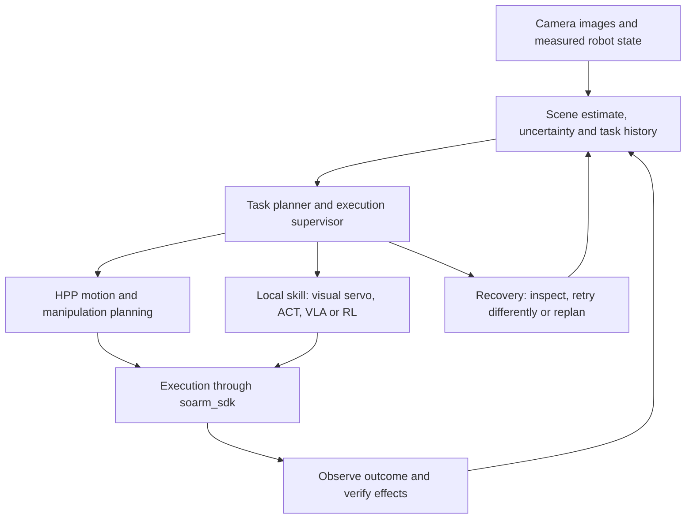

# SO-ARM development roadmap: perception, reliable tasks, and learned skills

Date: 2026-09-19. Status: proposal grounded in the current working tree and recorded results. Milestones and numerical targets below are proposed acceptance criteria, not achieved results. This review did not operate the arm or cameras or rerun training.

## Direction

Develop SO-ARM into a small, measurable manipulation platform: observe the workspace, plan useful actions, execute with feedback, verify their effects, and recover from ordinary failures. Preserve the investment in `soarm_sdk`, HPP/`long_tamp`, teleoperation, recording, and MuJoCo. Introduce learned policies through the same skill interface as classical controllers.

The first reference task is a known 30 mm cube placed at varying reachable positions. The next is a three-object tabletop rearrangement that requires several picks, temporary placement, and recovery from a missed grasp or changed scene. Learned alignment or regrasp comes after those execution and observation interfaces work.

Work remains in `soarm-ws`. `agimus-ws` is an implementation reference only. The detailed [perception plan](perception-tamp-integration-plan.md) remains the camera implementation reference; the [MJLab roadmap](../SOARM_MJLAB_ROADMAP.md) and [training log](../soarm_mjlab/docs/reach_training_debug_log.md) retain the RL history. This document sets priorities across them.

## What we actually have

| Foundation | Evidence in the checkout | Implication for the roadmap |
| --- | --- | --- |
| Hardware interface and calibration | `soarm_sdk.RobotInterface`, servo transport, calibration mapping, joint/step limits, telemetry and dashboards | Keep one hardware control path and explicit frame conversion for every producer of commands. |
| HPP planning and host execution | `soarm_tamp` plans in a container and streams manifests on the host; measured-start support, tracking checks, scene fingerprints, and regression tests exist | Extend this working boundary with scene observations and phase outcomes. |
| Nominal object geometry | `geometry.py`, YAML and generated assets use 30 mm and resting centre `z=0.015`; `test_scene_geometry.py` checks geometry and grasp relationships | Geometry reconciliation is implemented. Physical size, grasp margin and new live runs still need measurement. |
| Physical execution evidence | TAMP records a TCP reach with 7.0 mm / 2.2 degree error. Root README claims live pick-and-place; package README/skill describe that task as dry-run only | Resolve the documentation discrepancy using recorded runs; establish a repeatable baseline for the current geometry. Neither claim establishes a measured pick success rate. |
| Camera intrinsics and viewing | OpenCV calibration, ArUco tools and Rerun; `webcam_screen_20260918_take2.json`: 1280x720, 20 images, saved reprojection error 0.81877 px | Validate intrinsics on held-out images, then establish camera-to-base extrinsics. The artifact alone does not establish metric robot-frame accuracy. |
| Demonstration capture | `m5teleop --record` calls `soarm_lerobot`; current recorder has no images and writes one vector into both state and action | The caller supplies its IK configuration. Add independently measured state, actual commands, jaw commands and synchronized images before collecting a training corpus. |
| Imitation training | `soarm_lerobot/soarm_lerobot/scripts/train.py` contains ACT and Diffusion Policy stubs | Integrate an upstream trainer and policy adapter; do not count the CLI as working training. |
| RL infrastructure | MuJoCo/mjlab training, tests and campaign logs exist; `deploy/` contains a README describing an unimplemented runner | Useful research infrastructure, without a demonstrated hardware policy deployment. |
| RL results | Logs report v12 IK-dominated early success of 93.8–97.5%, trained v12 38.3%, trained v13 48.7%, under the existing reach metrics | Resolve evaluation/reward issues and compare against IK before more training. These centimetre-scale position metrics do not demonstrate grasp readiness or accurate orientation. |

Source files: [TAMP task](../soarm_tamp/soarm_tamp/plan.py), [executor](../soarm_tamp/soarm_tamp/execute.py), [geometry tests](../soarm_tamp/tests/test_scene_geometry.py), [camera artifact](../camera_calibration/data/webcam_screen_20260918_take2.json), [teleop loop](../m5teleop/teleop.py), [recorder](../soarm_lerobot/soarm_lerobot/recorder.py), [training stubs](../soarm_lerobot/soarm_lerobot/scripts/train.py), [RL results](../soarm_mjlab/docs/reach_training_debug_log.md).

Some package skills and root summaries lag behind the code: TAMP now has regression tests, and the RL log includes v13. Prefer inspected code and dated run evidence when reconciling them.

## Architecture to grow toward



The supervisor grants command ownership to exactly one executor at a time. HPP and a local policy never write competing commands. A handoff includes measured joint state, the current scene revision, the selected grasp and its allowed variation, and the skill's entry/exit conditions.

HPP remains responsible for geometric feasibility under its scene model. The supervisor maintains task progress and decides what to try next. Learned models can propose strategies and implement local skills. Observed outcomes update the task state; a predicted effect or finished trajectory is insufficient evidence of success.

Keep the host/container manifest boundary for planning. Add versioned observation and execution-result artifacts beside it. A future fast local controller runs on the host; per-frame corrections should not require starting container planning jobs or rereading a large manifest.

## Delivery sequence

Stages are ordered by dependencies, with completion determined by evidence. Camera integration and corrected recording can proceed together. Calendar estimates should be assigned after the first physical baseline, since calibration and servo error may dominate the work.

| Stage | Deliverable | Acceptance evidence |
| --- | --- | --- |
| M0 — Reproducible baseline | Current geometry, calibration, execution settings and benchmark recorded together | Repeatable TCP/pick trials; measured errors and outcomes; documentation reconciled |
| M1 — Observe in robot coordinates | Validated camera-to-base transform and timestamped cube observations | Held-out position errors, repeatability, missing/occluded-object handling |
| M2 — Vision-guided pick and place | Measured object pose feeds HPP; scene checked before motion and outcome checked afterward | Proposed target: at least 45/50 first-attempt successes across declared reachable placements, with every trial retained |
| M3 — Recoverable multi-step tasks | Phase executor, skill contracts, persistent task state, bounded recovery | Three-object rearrangement; injected misses, scene changes and interruptions; completion and intervention statistics |
| M4 — One learned local skill | Camera-equipped demonstrations, upstream ACT training, interchangeable skill adapter | Held-out comparison against the classical controller under equal trial conditions |
| M5 — Generalization and dexterity | Selected unknown objects, richer sensing where needed, VLA/WAM experiments | Improvement in full-task completion, recovery or throughput on unseen evaluation cases |

### M0 — Establish the physical and software baseline

Owner: `soarm_tamp` with `soarm_sdk`; evidence index in workspace docs.

M0 answers three questions before vision enters the control loop: does the arm arrive where HPP expects, can the physical 30 mm cube be grasped using the nominal fixed scene, and can we reconstruct why a trial failed? M0 keeps the cube at YAML pick A `(0.22, -0.10)` and destination B `(0.22, +0.10)` in the SO-101 base frame. Moving the cube to new locations is an M2 experiment, because the present planner has no observation-driven object pose.

#### M0.1 — Freeze a reproducible experiment

Use a session ID and a fresh, distinct `soarm_tamp/runs/m0/<session>/<trial>/` directory for every plan. Never overwrite a historical run. Record a session sheet and keep the plan's existing `manifest.json`, `scene.json`, segment files and `live.jsonl`. An old `runs/cube30/manifest.json` still contains `z=0.0125 m` in its cube start configuration, so its successful playback or command trace cannot validate today's 30 mm scene. Replan from the current YAML and generated assets.

Record at least these fields before the first trial:

| Field | Why it is needed |
| --- | --- |
| Workspace and `soarm_tamp` / `soarm_sdk` revisions, dirty diff identifiers, generated asset hashes | Reproduce the exact planning and command code; current worktrees contain changes. |
| Arm ID, calibration path/hash and `validated` flag, actual EEPROM joint limits | Distinguish a changed joint mapping or physical stop from a planning regression. |
| Physical cube edge lengths on all three axes, approximate mass, jaw settings | Check model mismatch; the 30 mm dimension remains approximate until measured. |
| Base mounting and table geometry, A/B marks, physical TCP measurement point and its offset from `gripper_frame_link` | Tie ruler or fixture readings to the planner's coordinate frames. |
| Port, start-pose file, target pose, plan seed, execution flags, time, operator and supervision setup | Make a failed trial independently interpretable. |

Do not copy a nominal tool pose into the “measured” column. Choose a visible reference on the gripper or a rigid measurement pointer, determine its transform from the URDF TCP, and record any uncertainty in that offset. A pointer changes the robot's collision envelope; account for that in the scene or use it only in a separately validated, clearance-safe reach experiment. Mark A/B with a ruler and tape if no printed board is available. Keep the base and table fixed throughout a session.

#### M0.2 — Check software and physical setup

From `soarm_tamp/`, run `python -m pytest -q tests` (19 host-side tests passed in this roadmap review). It covers nominal cube geometry, generated grasp frames, stale-scene rejection, gripper hold, abort-on-drift and dashboard behavior. Add focused CI for this host suite during M0 implementation. Run planning and dry-run checks in addition to tests; they exercise the actual HPP container and manifest boundary. Keep container smoke tests in a separate job that has the image available.

Verify the current YAML cube centre is `z=0.015 m`, generated cube size is `0.030 m`, the `cube/top` and robot grasp frames match `geometry.py`, and `scene.json` matches the current fingerprint. Rebuild assets with `python -m soarm_tamp.build_assets` only when source geometry/model inputs changed, then review the generated diff and replan. Inspect the bench: arm base and table reference, cube size and location, mounting rigidity, jaw movement, clear approach corridor and actual power/bus state.

Use the saved SO-101 calibration only if it is marked validated for this arm. If it is not, use the existing guided calibration or `python -m soarm_tamp.validate_calibration --port /dev/cu.usbmodemXXXX`, which performs deliberate physical motion and a tape-measure FK check. Its default 15 mm FK tolerance is a coarse mapping gate, not proof of millimetre-level grasp accuracy. Record the validation result and do not use `execute --force` to make a benchmark run. Read the arm before planning; `read_pose` rejects a missing or unstable servo reading. For cube plans, set the physical jaw to 20° before the start read, within the planner's 1° check.

For each planned trial, preview the manifest and use `execute --dry-run --no-trace`. The executor opens `live.jsonl` with truncation, so a dry run in the same plan directory would otherwise leave a trace that the live run overwrites; retain the dry-run console output separately. Then confirm the arm's live EEPROM limits, physical object/table placement and unobstructed path before any supervised execution. Preserve synchronization and the existing command/lag limits. Stop a run after collision, unexpected motion, tracking abort, loss of bus feedback, a shifted cube or a changed scene; record it as a failed attempt rather than silently repeating it.

An example TCP trial, run from `soarm_tamp/` with a fresh run name and the actual port, is:

```bash
python -m soarm_tamp.read_pose --port /dev/cu.usbmodemXXXX \
  --out runs/m0/start_tcp01.json
./scripts/hpp_container.sh tcp --start runs/m0/start_tcp01.json \
  --xyz 0.22 0.0 0.05 --rpy 180 0 0 --viewer none \
  --out runs/m0/tcp01
python -m soarm_tamp.execute runs/m0/tcp01 --dry-run --no-trace
# After preview and physical preflight, supervised live trial:
python -m soarm_tamp.execute runs/m0/tcp01 --port /dev/cu.usbmodemXXXX
```

For the fixed cube task, read a new start pose with the jaw at 20°, use `./scripts/hpp_container.sh plan --start runs/m0/start_cube01.json --viewer none --out runs/m0/cube01`, dry-run that fresh manifest, and run it under the same supervision. Capture a new start pose and plan after any arm motion or manual reset; `--start` is what prevents an unchecked slew to the YAML's nominal joint zero.

#### M0.3 — Measure reach and grasp separately

Begin with TCP reach because it avoids contact. With the cube remaining at A, a proposed initial grid is `(0.22, 0, 0.05)`, `(0.22, +0.05, 0.05)` and `(0.22, +0.10, 0.05)` metres, hand down. These are candidate targets inside the previously studied annulus, not guaranteed safe paths: accept each only after planning, collision review, dry-run and physical clearance check. Run five repeated reaches per accepted target, alternating at least two safe measured starts where practical, and repeat on a second session. Keep every rejected target in the feasibility record rather than replacing it without explanation.

At each arrival, measure the chosen physical reference point in the base frame and, if possible, its approach direction. Record the independent measurement method and resolution. Measure at least twice after the arm settles. Capture final servo joints with `read_pose`, then compare three different quantities: `FK(q_plan)` versus the intended target (planner error), `FK(q_measured)` versus `FK(q_plan)` (endpoint tracking error), and the independent physical point versus `FK(q_measured)` (model/calibration/tool-offset error). Apply the recorded TCP-to-reference-point offset to both FK results when the visible measurement point differs from the TCP. If manual measurement uncertainty is close to the claimed error, report an interval and improve the fixture before drawing a sub-millimetre conclusion. Compute per-target bias, within-target spread, worst error and direction-dependent difference; one best reach is not a repeatability result.

Use the fixed cube at A for the first contact experiment. Begin with one supervised pick-and-place, inspect it, then plan roughly ten attempts across two setup sessions if early trials are uneventful. Reset A/B deliberately and measure their positions each time. Before and after every attempt, record independent object location and orientation, the jaw opening, and a camera image or video for review. An ordinary RGB video can document the outcome without serving as metric ground truth before camera-to-base calibration. Label grasp contact, whether the cube followed the hand, whether it was dropped in transport, and final placement independently. If a later stage becomes unsafe or unobservable, stop that trial and label the outcome; the current executor cannot safely resume an arbitrary segment.

The existing `live.jsonl` is a trace of **commanded** joints and jaw events, not measured joints or observed object state. Save console output for the run's worst lag, settle error, timeout and clamp counters. During M0, add a minimal asynchronous trace of already-read measured joints at segment boundaries and at grasp/release, with monotonic timestamps and an explicit `measured_q` field; avoid extra servo-bus reads on the timing path. Check the resulting measured trace against an independent `read_pose` at the end. This small instrumentation change is more useful than a new dashboard for diagnosing the first cube failures.

#### M0.4 — Count failures and decide what to fix next

Keep one trial row per planned target/physical attempt. A useful initial schema is `session_id`, `trial_id`, `task`, `start_pose_file`, `run_dir`, `target`, `plan_status`, `preflight_status`, `execution_status`, `physical_pick`, `transport`, `physical_place`, `measured_tcp_error_mm`, `max_joint_lag_rad`, `limit_clamps`, `step_clamps`, `failure_category`, `operator_note` and `evidence_paths`. Use `success`, `failure` or `unknown` for physical outcome; do not turn missing video or occlusion into a success. Keep planning feasibility, execution reliability and task success as separate denominators.

Classify each failed attempt by its first observed cause: scene/model mismatch, no plan, unsafe start, hardware limit, path tracking/timeout, tool-point/calibration bias, poor grasp alignment, failed closure, drop, placement error or unknown. Track every intervention and whether the same failure recurred. A zero-success contact campaign can still complete M0 if it isolates a reproducible cause; it cannot justify the M2 success target.

The documented 7 mm TCP error and nominal 3.25 mm clearance per jaw side describe different measurements, but together they warn against assuming that better object localization alone will solve grasping. Use the measured error budget to choose among calibration/model correction, approach restriction, jaw/handle geometry correction and local visual alignment. Separate a repeatable fixed bias, which may be calibrated, from variable error, which needs feedback or a larger grasp margin.

M0 exits with (1) a fresh, reproducible plan-and-execution bundle for the current 30 mm scene; (2) repeated TCP error and physical cube outcome tables with measurement uncertainty; (3) at least one preserved failure trace or a documented failure-free trial set; (4) a bounded operating region and a ranked cause of failure; and (5) corrected root/package status claims linked to actual run evidence. No arbitrary new precision threshold is imposed before measuring the arm's repeatability. M1 camera work can run in parallel, but M2 live grasp claims require this baseline.

### M1 — One camera, trustworthy scene observations

Owner: `camera_calibration` for calibration; a small optional `soarm_vision` package for runtime perception, as proposed in the perception plan. Create the package when the first observation path is implemented; repository publication is a separate operation.

1. Validate the saved intrinsics at the runtime resolution and focus, using held-out views across the working area. Preserve the screen chessboard as the no-printer option. Intrinsic calibration does not itself determine camera-to-base pose.
2. Fix the webcam mechanically. With no printer, use clearly identifiable physical reference points whose coordinates relative to the robot base are independently measured. A manual point-selection tool plus OpenCV `solvePnP` is a reasonable initial extrinsic workflow; a measured physical board is an alternative when available. Collect more correspondences than the minimum and validate on separate points. A movable laptop screen only supplies base-frame calibration if its pose relative to the base is also measured.
3. Start object estimation with the known cube on the known table: detect its top-face corners/contour, apply geometric constraints, and reject ambiguous observations. A marker is an alternative if a measured marker can be obtained. Do not make access to a printer a prerequisite.
4. Respect surface height in image-to-world geometry: the top face is at `z=0.030 m`, the centre at `z=0.015 m`, and the table at `z=0`. A top-face pixel projected onto the table gives a biased XY position. Treat cube yaw/symmetry explicitly; the free HPP rotation does not make every physical jaw alignment equally good.
5. Produce scene snapshots with object identity, pose/frame, timestamps, calibration/model versions, quality evidence and observed/stale/occluded status. Use latest-frame processing; record images, estimates and rejection reasons in Rerun.

OpenCV provides the metric pose solver from 3D–2D correspondences; our code supplies measured reference geometry and frame conventions. [OpenCV PnP](https://docs.opencv.org/4.13.0/d5/d1f/calib3d_solvePnP.html)

Exit: independently measured object-position error across the pick area, latency and repeatability distributions, and successful rejection of invalid resolution/calibration/visibility cases. Declare the pose-error budget before live grasp trials, based on the remaining physical grasp margin.

### M2 — Close the cube observation-to-action loop

Owner: `soarm_tamp` consumes observations from `soarm_vision`.

1. Implement `plan --scene <snapshot>` while preserving the nominal YAML as an offline fixture. Resolve the cube free-flyer block from the loaded model, rather than assuming fixed offsets. Apply the observation after measured-arm start-state loading, which otherwise risks rebuilding the nominal object state.
2. Separate static geometry validation from dynamic observed pose validation. Currently `validate_nominal_scene` checks the fixed PICK_XY and `scene_fingerprint` includes pick/place coordinates. Preserve those checks for the offline fixture; add observation provenance and planned live pose without misclassifying every new cube position as changed geometry.
3. Keep `cube/top` relative to the object. Vision updates the object root, so `T_base_handle = T_base_object @ T_object_handle`. No per-frame SRDF rewrite is needed for this cube.
4. Re-observe before execution and reject/replan a changed scene. Capture actual measured arm state for planning and check that execution begins from a compatible state.
5. Verify pick and place separately. Where possible, verify that the object moves with the gripper during a small feasible lift and later rests in the destination region after release. Occlusion or a closed-jaw command alone leaves the result unknown.
6. If M0/M1 show that open-loop terminal accuracy misses the grasp budget, add a bounded local visual alignment skill before claiming repeatable performance. Keep standoff/lift poses inside this arm's measured workspace; do not assume a generic 10 cm vertical approach is reachable.

Exit: proposed engineering gate of at least 45/50 first-attempt successful placements over a predefined placement set spanning at least two sessions. Include timeouts and rejected valid trials in the denominator; report perception rejections separately. Retain failures and independent outcome labels. This is an initial gate, not evidence of production reliability.

### M3 — Make execution resumable and recovery explicit

Owner: start within `soarm_tamp`; extract a shared orchestration package only when multiple consumers need it.

1. Split execution into observable phases: observe, approach, align, grasp, verify-held, transport, place, verify-placed. Preserve the existing manifest playback as the motion-skill implementation.
2. Give each skill arguments, entry conditions, allowed changes, timeout/cancellation behavior, success evidence, and typed failure outcomes. Results contain the actual final robot/object state and the evidence supporting the claimed effect.
3. Replace cube-specific jaw scheduling as tasks grow. `_gripper_plan()` currently inspects `spot_b` edge names; general tasks need explicit gripper events in the manifest or skill result contract.
4. Persist task state and an event journal. Resume from a fresh observation and compatible checkpoint. Never infer the current grasp state solely from the last command before interruption.
5. Implement failure-specific recovery: inspect after occlusion; re-estimate and choose another grasp after a miss; replan after a moved obstacle; return a bounded failure when the arm cannot track. Retrying requires new evidence or a changed strategy, with finite attempt/time budgets.
6. After a local controller changes the grasp, estimate or conservatively bound the actual object-to-gripper transform and regenerate the carrying plan. Do not resume a trajectory that assumes a different rigid attachment.

A small explicit state machine is sufficient initially; `transitions` supplies Python states, guards and callbacks. Use a task-planner interface once the three-object task genuinely requires ordering choices or temporary placement; Unified Planning is a candidate front end, with an appropriate engine selected then. HPP remains the geometric feasibility component, and planner timeout should be distinguished from a proven infeasible action. [transitions](https://github.com/pytransitions/transitions), [Unified Planning](https://unified-planning.readthedocs.io/en/latest/)

Reference task: move three objects to specified regions, including one blocking a target and requiring temporary placement. First validate nominal sequences, then introduce bounded object displacement, a missed grasp, observation loss and an interrupted run. Begin fault injection in replay/simulation before controlled physical trials.

Exit: proposed target of at least 27/30 complete nominal tasks over multiple sessions. Report a separate recovery campaign by failure type, with recovery success, retry count, false-success decisions and intervention rate. A recovery can be correctly refused when its prerequisites cannot be established.

### M4 — Make the first learned skill useful

Owner: `m5teleop` provides demonstrations, `soarm_lerobot` stores/trains them, and the M3 supervisor deploys the skill through `soarm_sdk`.

Start recording improvements alongside M1/M2; wait for stable handoff conditions before training a local skill.

1. Record independently measured joints and actual sent commands, camera frames with capture/receipt timing, jaw state and command, task/skill IDs, calibration versions, outcomes and interventions. Name joint frames explicitly. Convert at one tested boundary to the SO-101 URDF frame used by planning; older data requires an explicit migration decision.
2. Use episode-aware sampling and hold out entire episodes, placement regions and collection sessions. The current chunk wrapper builds windows across flattened arrays; prevent episode-boundary leakage. Fit normalizers only on training data.
3. Wire the existing package to a pinned upstream LeRobot ACT trainer. Reuse the dataset/training implementation and add only the SO-ARM adapters. Test installed-version compatibility rather than assuming current documentation matches this checkout. ACT is already supplied by LeRobot. [LeRobot ACT](https://huggingface.co/docs/lerobot/act)
4. Select one measured weakness, such as visually aligning the jaw from a reachable pre-grasp region or recovering a misaligned cube. Begin with a pilot of roughly 50 diverse successful demonstrations plus labelled corrections/failures, then size further collection from learning curves. That count is a starting budget, not a sufficiency claim.
5. Validate action units, ordering, jaw semantics, latency, action chunks and cancellation in replay before controlled deployment. The policy uses the same command-ownership and outcome contract as the classical skill.
6. Compare HPP plus classical alignment with HPP plus ACT on the same held-out cases, allowing equal recovery budgets. Count full-task completion, interventions, cycle time and prediction/feedback latency.

Exit: retain a policy when repeated held-out trials show a useful gain, or comparable completion with better throughput, without unacceptable regression in monitored outcomes. A decreasing training loss is insufficient.

The TAMP-to-local-policy decomposition is supported by SPIRE's research approach, but our interface and evaluation must be adapted to this arm and task. [SPIRE](https://arxiv.org/abs/2410.18065)

### M5 — Expand object variety, dexterity and reasoning

Advance one source of difficulty at a time: new placements, new rigid shapes, occlusion/clutter, contact complexity, then longer sequences.

- For unknown rigid objects, estimate usable geometry and candidate grasps, create object-relative handles before HPP graph construction, and include collision/placement assumptions. One RGB view supplies limited hidden geometry and metric height information; initially constrain the task or request another view/measurement.
- Evaluate the ESP32 as an auxiliary view for grip verification. Measure image quality, timestamp/transport latency and calibration stability first. It should not automatically become the precision-control camera.
- Add RGB-D or a suitable wrist camera if measured observability limits justify it. New sensing needs an error/latency budget and a demonstrated improvement, rather than a hardware purchase preceding the diagnosis.
- Evaluate a supported VLA such as SmolVLA behind the established policy adapter once multi-object or language-conditioned behavior adds value. Keep ACT and classical controllers as baselines. [LeRobot SmolVLA](https://huggingface.co/docs/lerobot/smolvla)
- Explore WAMs offline on recorded episodes first: prediction quality, embodiment adaptation, latency, and sensitivity to task-critical geometry. Progress to action proposals or local control only after comparison on the same task suite. Existing DreamZero tooling provides a research starting point; deployment feasibility on our compute and SO-101 remains to be established. [DreamZero](https://github.com/dreamzero0/dreamzero)
- Add semantic problem solving through validated skill calls: choose a different grasp, move a blocker, inspect, or change the subgoal order. Keep an execution history so repeated failures affect the next choice.

The SO-101 has five arm joints plus a jaw, limited payload, coupled reach/orientation, and position-controlled servos. Define dexterity experiments around reachable tasks. Tight insertion, compliant contact, in-hand manipulation and bimanual work require separate checks of sensing and hardware suitability; a larger policy cannot supply missing mechanical capability.

## Role of the existing RL branch

Continue `soarm_mjlab` as a targeted research track, without making the camera-guided cube task wait for it.

First reproduce a zero-residual IK baseline and selected learned checkpoints under the same held-out seeds and final task tolerances. The log diagnoses reward saturation and documents position-only success; treat those as hypotheses and evidence to test, not a reason to extend training blindly. Use reachable task-relevant orientation constraints for this five-DOF arm rather than requiring arbitrary full-pose targets.

Next, identify a failure the base controller actually exhibits: model bias, load-dependent error, delay or a limited contact skill. Match the simulation task and actuator behavior to that failure using M0 telemetry. Only then evaluate residual learning, including a zero-residual ablation and sim/deployment preprocessing parity. The existing deployment runner remains work to implement after a policy passes its defined simulation gate.

## Ownership and artifacts

| Component | Responsibility |
| --- | --- |
| `soarm_sdk` | Robot state, frame conversion, transport, command limits and hardware telemetry |
| `camera_calibration` | Intrinsics, camera/base calibration artifacts and validation utilities |
| proposed `soarm_vision` | Capture, runtime detection/tracking, object pose and observation quality |
| `soarm_tamp` | Scene ingestion, HPP integration, manifests, phase execution and initial supervisor |
| `m5teleop` | Human demonstration and intervention entry point |
| `soarm_lerobot` | Synchronized datasets, upstream training adapters, policy preprocessing |
| `soarm_mjlab` | Simulation, actuator/task studies and targeted RL experiments |

Keep a run bundle containing scene/start-state snapshots, calibration and model identifiers, manifest, command/measurement/event traces, camera recording references, and independently checked outcomes. Use Rerun for synchronized inspection and Viser for the existing dashboard. JSON artifacts remain the planning boundary. Avoid adding a ROS migration, a second hardware driver, or another UI framework without a concrete task requirement.

## Measurement and prioritization

The primary score is complete task success over all attempted trials. Also report first-attempt success, success after recovery, false-success decisions, human interventions, successful tasks per hour, pose/tracking errors, and the failure category. Define destination tolerance, retry budget and task timeout before each campaign. Keep training, tuning and held-out sessions separate, report sample counts and confidence intervals, and preserve the worst cases.

The 45/50 and 27/30 gates are small engineering screens. They do not establish a 99% reliability claim. Benchmark the final task, because excellent grasp percentages can still produce poor completion over many sequential actions.

Suggested effort allocation through M3: roughly 70% perception/execution/recovery, 20% recording and evaluation, 10% bounded learning experiments. Revisit after the first measured failures reveal the bottleneck.

## Immediate work queue

1. Capture the M0 evidence inventory, run existing geometry/executor checks, and establish current physical TCP/pick repeatability.
2. Validate the saved webcam calibration and create the no-printer camera-to-base calibration workflow using independently measured reference points.
3. Produce a replayable cube observation in the robot base frame with quality and freshness metadata.
4. Implement scene ingestion and provenance in `soarm_tamp`, retaining nominal offline behavior and measured-arm starts.
5. Run observed pick/place trials and use their failure breakdown to decide whether the next implementation is alignment, visibility improvement, or model/calibration correction.

The next substantial demonstration should show the robot finding a relocated cube, planning from its actual arm state, attempting the task, and determining the physical outcome. That produces the observations, failure cases and execution boundaries needed for both longer TAMP tasks and useful learned skills.
